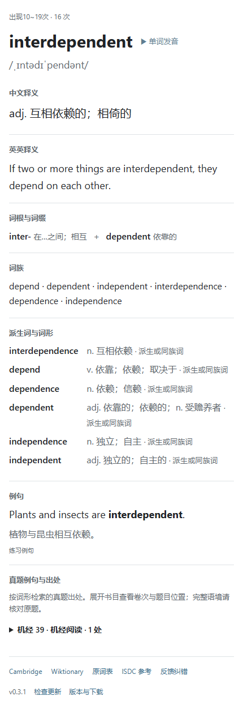

# 雅思核心词汇 Anki 牌组

英文 → 中文，按原词表频次分为五个子牌组。支持 Windows Anki、AnkiDroid 和 AnkiMobile。

**[下载最新卡包](https://github.com/tentyou/anki-ielts-decks/releases/latest)** · **[反馈错误](https://github.com/tentyou/anki-ielts-decks/issues/new?template=correction.yml)**

当前版本 **v0.3.1**：12,155 张卡片，17,091 句中英例句，11,785 条英英释义，1,454 个词条有构词提示或词族，3,962 个词条有派生词或词形；只包含单词离线音频。



[下载 v0.3.1 卡片预览 HTML](docs/card-preview.html)（下载后用浏览器打开，预览中的发音按钮仅作占位）

## 内容

- 正面显示英文单词和单词播放按钮；反面显示音标、中文释义、双语例句与来源。
- 部分词条显示「词根与词缀」、「词族」、「英英释义」及「派生词与词形」，没有合适内容时整个栏目隐藏。
- 构词区分现代前后缀、词基、常见词族及少量有依据的外语词根，不把拼写相似当作词源。词基在派生时可能发生拼写变化。不同词义不能仅通过构词相加推导。
- 单词发音为 Microsoft Zira Desktop 美式 TTS 生成的 MP3；不是依赖设备语音引擎的动态 TTS。音标沿用原站及先前补全，部分音标与美式发音存在差异。
- 没有例句音频，没有联网音频脚本，不显示自动音标或未人工校订提示。
- 卡片附词典与 GitHub 反馈入口。

参考 [anki-jlpt-decks](https://github.com/5mdld/anki-jlpt-decks) 的项目组织、发行和社区纠错方式；本项目没有复制该项目的代码、日语数据或媒体。

## 下载、安装及更新

1. 从 [Releases](https://github.com/tentyou/anki-ielts-decks/releases) 下载 `.apkg`，不要把 GitHub 的 Source code ZIP 当成卡包。
2. 在桌面 Anki 中导入。更新已有版本时，允许更新笔记与笔记类型，并打开合并笔记类型；需要时选择「始终更新」。
3. 使用同一 AnkiWeb 账户同步到 AnkiDroid / AnkiMobile，等待媒体同步完成后再离线学习。

沿用早期卡包的笔记 GUID、模型 ID、牌组 ID 和卡片模板序号。v0.2.0 追加 `Morphology` 与 `WordFamily`，v0.3.0 再追加 `EnglishDefinition`、`Derivatives`、`ExamExamples`，共 25 个字段，不改变旧字段次序；在独立 Anki 测试库验证升级及复习计划保留。导入仍可能覆盖你自己对原字段的修改，更新前请备份。

从带例句音频的旧完整版升级不会自动删除旧媒体。需要释放空间时，在桌面 Anki「工具 → 检查媒体」中检查未使用文件后清理，再同步。

## 更新检测

v0.3.1 起，正反面底部显示当前模板版本、「检查更新」和「版本与下载」。默认自动查询 GitHub 最新稳定发行版，成功结果缓存 24 小时；手动点击「检查更新」可立即重新查询。有新版时，链接显示「发现 v… · 下载」。下载 `.apkg` 后仍需手动导入、更新笔记类型并同步；此功能不会自动安装或修改复习计划。旧版 v0.3.0 及以前没有检测脚本，需要先手动升级一次。

检测只请求 `https://api.github.com/repos/tentyou/anki-ielts-decks/releases/latest`，不上传单词、笔记或学习记录。6 秒超时；失败后自动检测延后 1 小时，保留已知的新版提示。断网自动检查静默失败，手动检查会提示使用下载入口。GitHub 无法访问、限流或客户端禁止跨域请求时，自动检测可能不可用，「版本与下载」仍可手动打开。

采用 Windows Anki、AnkiDroid 和 AnkiMobile WebView 通用的 JavaScript／XMLHttpRequest，不需要插件；缓存无法写入时使用当前 WebView 内存缓存，关闭或重建 WebView 后可能重新检查，缓存不通过 AnkiWeb 同步。浏览器模拟、实际桌面 Anki 导入已验证，尚未在 Android／iOS 真机实测。

`updateCheck: false` 隐藏整个检测模块并停止该面的自动请求，正反面分别设置。当前版本取构建时写入模板的版本号，不从笔记上可能累积的旧版本标签推断；只更新模板不等于已更新词条数据。

## 校订范围

曾出现 `crane`「起重机」配「鹤」的例句：原因是只匹配拼写、没有确认所列词义。已有两轮集中修正，相关替换记录与回归校验现在进入版本控制。v0.2.0 又补查了名词、动词及专名冲突，例如 `sue` / Sue、`kindle` / Kindle、`tire` / tyre。

例句含 Tatoeba、Global Voices 语料，以及编写的教学或模板练习句；部分中文由机器翻译补齐。**没有对全部例句逐句完成人工校订，也不保证消除了所有词义、语法和翻译问题。** 自动规则和词性模型只生成候选，不能作为语义正确性的证明。维护状态保存在 JSONL 的 `review` 字段，不在学习卡片上弹出提示。

参考站 [雅思词典](https://isdc.pages.dev/) 匹配 11,798 个词条。英英释义经去重、长度和词性过滤，181 条重点词义另行修订；派生词只保留可核对的屈折变化与词族关系。新增构词候选中排除了 756 项，保留 716 项。`income = in-（不）+ come`、`legal = leg（腿）+ -al` 等自动拆词不会加入。已有同源资料不算独立验证，所有新增内容也未逐条完成人工审校。

**真题模块放在普通例句下。** 为 10,219 个词条保留书目、Test／Passage／Part 位置、检索词形及匹配条数；书目默认折叠，点击可展开全部出处。位置来自原站，不能当作页码或官方逐句核验结果。按词形匹配不保证每个位置都采用当前词义，核对原题语境后再学习。真题原文没有整库转载，目前仅 `crane` 含一段 9 个英语单词的短引文及中文翻译。索引不是完整真题例句集。

## 模块显示开关

所有开关默认 `true`。在 Anki「卡片」编辑器的正面／背面模板底部找到 `var modules`，把需要隐藏的模块设为 `false`，两面请分别修改。下载包中已内嵌配置，不需要额外安装 JS 文件。源码维护时编辑 `templates/module-settings.js` 后重新构建即可同时更新两面。

| 开关 | 控制内容 |
| --- | --- |
| `frequency` | 分组与频次 |
| `wordAudio` | 单词播放按钮 |
| `ipa` | 音标 |
| `meaning` | 中文释义 |
| `englishDefinition` | 英英释义 |
| `morphology` | 词根与词缀 |
| `wordFamily` | 词族 |
| `derivatives` | 派生词与词形 |
| `examples` | 普通双语例句 |
| `examExamples` | 真题短引文与出处索引 |
| `sources` | 词典及来源链接 |
| `updateCheck` | 版本、自动检查及手动更新入口 |

例如 `englishDefinition: false` 隐藏英英释义。没有内容的栏目会自动省略，即使开关为 `true` 也不会显示空标题。隐藏音频按钮不控制 Anki 自身的自动播放；需要静音时另行关闭牌组选项中的自动播放音频。

## 参与迭代

- 单词、释义、例句、翻译：编辑 `deck-source/*.jsonl` 中相应词条；每行一条，`guid` 请保持不变。
- 构词、词族：编辑 `deck-source/morphology.json`；优先有把握的现代构词，无可靠解释时留空。
- 已知消歧例句：`deck-source/example-overrides.json` 保存本轮有意选择的双语例句。修改时同时更新 JSONL 与补丁，运行校验。
- 英英释义、派生词与真题出处：`deck-source/enrichment/*.jsonl`；重点释义补丁为 `definition-overrides.json`，新增构词记录为 `reviewed-root-additions.json`。
- 卡片外观：`templates/front.html`、`back.html`、`style.css`。
- 提交 PR 前运行下面的检查；[贡献说明](CONTRIBUTING.md) 介绍如何提供语境和依据。

## 本地构建

需要 Python 3.10+。所有脚本只读写项目文件，不访问你的 Anki 个人资料库。

```sh
python -m venv .venv
# 激活虚拟环境后：
python -m pip install -r requirements.txt
python scripts/validate.py
python -m unittest discover -s tests -v
# 可选，需要 Node.js：
node scripts/test_module_settings.cjs
node scripts/test_update_check.cjs
```

只有源码时可以生成不带音频的测试卡包：

```sh
python scripts/build.py --text-only --output dist/text-only.apkg
```

生成完整版本，先下载本项目任一含音频的发行卡包，并提取单词音频：

```sh
python scripts/extract_media.py path/to/downloaded.apkg
python scripts/build.py
```

音频通过 `media-manifest.json` 的 SHA-256 校验。`media/` 与 `dist/` 不进入 Git；成品及校验文件放在 Releases。构建可重现数据和模板内容；ZIP 时间戳与 Anki 修改时间会随构建变化，不承诺字节级完全相同。

可选的实际 Anki 升级检查（需额外安装 `anki==26.9.3`）：

```sh
python scripts/check_upgrade.py previous.apkg dist/anki-ielts-v0.3.1.apkg
```

此脚本新建临时测试库，导入前后版本、模拟一张已复习卡并检查卡片 ID 与计划保留，结束后关闭并清理测试库。

## 更新 ISDC 参考资料

可选安装 `requirements-import.txt`，将公开网页另存为 `work/isdc.html`，再运行：

```sh
node scripts/decode_isdc.cjs work/isdc.html work/isdc_raw.json
python -m pip install -r requirements-import.txt
python scripts/import_isdc.py work/isdc_raw.json
```

候选文件写入 `work/isdc-import/`，不会自动覆盖已审查数据。检查词义、词性、构词和来源后再合并到 `deck-source/enrichment/`。原始网页、完整真题正文和缓存不提交到 Git。导入工具不自动采纳原站拆词，构词须另行审查。

## 来源与许可

本项目代码及原创构词说明采用 MIT；第三方词表、例句和其他内容保留各自权利与许可，详见 [来源与许可](docs/SOURCES.md)。维护者已确认取得原作者授权，并提供了[原帖链接](https://linux.do/t/topic/2863425)及沟通截图作为记录；该授权不等于将原词表改授为 MIT，具体沟通与范围见来源说明。
